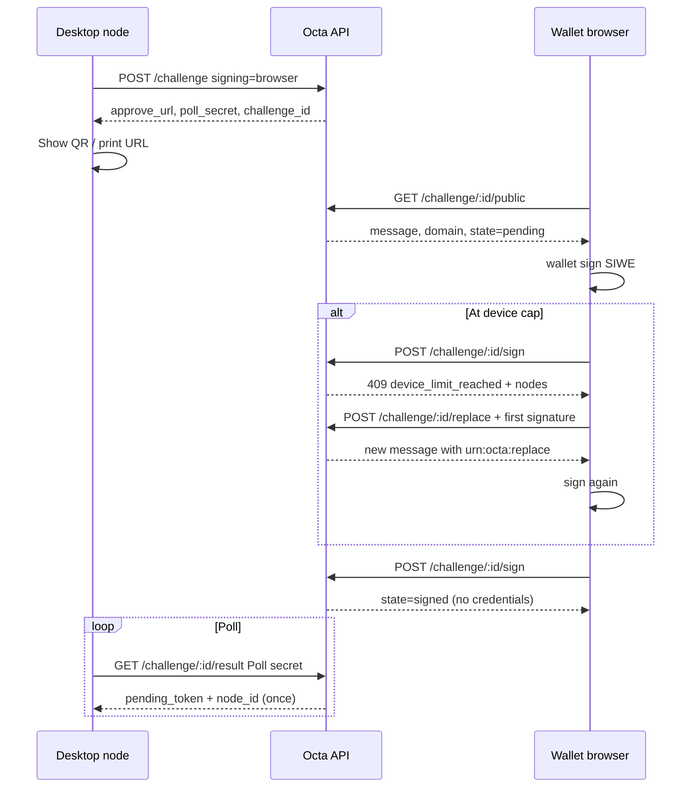

# Personal Node onboarding API (Octa Investment Group / Sarakt)

Server-side Vercel `/api/nodes/*` routes for wallet-signed Personal Node join, ZeroTier authorization, heartbeats, and Android app release metadata. **Migrations are committed only** — apply, in order:

1. `supabase/migrations/20260611170000_personal_node_onboarding.sql`
2. `supabase/migrations/20260611180000_node_events_and_challenge_binding.sql`
3. `supabase/migrations/20260611190000_node_join_atomic_replace.sql`
4. `supabase/migrations/20260611210000_zerotier_pending_retry.sql`
5. `supabase/migrations/20260611220000_device_key_and_node_invites.sql`
6. `supabase/migrations/20260611230000_optional_zerotier_v1.sql`
7. `supabase/migrations/20260611240000_node_suspended_browser_join.sql`

**Client:** The headless node / core runtime lives in **[CSN-ctrl/sarakt-node](https://github.com/CSN-ctrl/sarakt-node)**. This **Octa** repo owns the `/api/nodes/*` Vercel routes and Supabase migrations only.

**Depends on:** PR #20 (`cursor/sarakt-canonical-product-rules-67fe`) — Supabase bearer conventions, `is_dashboard_admin()`, plots / permits patterns.

---

## Environment variables (server-only unless noted)

| Variable | Required | Description |
|----------|----------|-------------|
| `SUPABASE_URL` | Yes | Same project as SPA |
| `SUPABASE_ANON_KEY` | Yes | For optional Supabase user linking |
| `SUPABASE_SERVICE_ROLE_KEY` | Yes | Node tables (no client `VITE_*`) |
| `ZEROTIER_API_TOKEN` | When `ZEROTIER_ENABLED=true` | ZeroTier Central API token |
| `ZEROTIER_NETWORK_ID` | When `ZEROTIER_ENABLED=true` | **Dedicated Personal Node** network (not validator infra) |
| `ZEROTIER_ENABLED` | No | Default **`false`** — v1 pilot joins/approves without Central; set `true` to enable authorize/deauth + retry |
| `NODE_JOIN_AUTO_APPROVE` | No | `true` to auto-approve (default **off** — manual governance approval) |
| `NODE_JOIN_DOMAIN` | Prod required | Canonical production origin (e.g. `https://www.sarakt.com`). **Production** challenges use this host only (must match request `Host`). |
| `NODE_JOIN_PREVIEW_PROJECT_SLUG` | Preview | Project slug for `{project}-<hash>-{team}.vercel.app` (hash = `[a-z0-9]+` only). |
| `NODE_JOIN_PREVIEW_TEAM_SLUG` | Preview | Team slug suffix (literal) for preview host pattern. |
| `NODE_JOIN_DEV_HOSTS` | Dev (`NODE_JOIN_ENVIRONMENT=development`) | Comma-separated allowed hosts (default `localhost:8080,127.0.0.1:8080`). |
| `NODE_JOIN_CHAIN_ID` | Prod required | EIP-155 chain ID in SIWE. **Pilot default `43113` (Avalanche Fuji)** when unset in **development** only; **must be set in production/staging** (fail closed) |
| `NODE_JOIN_ENVIRONMENT` | **Required** if `VERCEL_ENV` unset | `production` \| `staging` \| `development` (maps to SIWE `urn:octa:env:*`). Fail closed when neither this nor `VERCEL_ENV` is set. |
| `NODE_JOIN_CLOCK_SKEW_SECS` | No | Default `60` — allow `issuedAt` up to this many seconds in the future; allow `expirationTime` up to this many seconds in the past; reject `notBefore` beyond this skew when present |
| `NODE_MAX_ACTIVE_PER_WALLET` | No | Default `3` live (`pending` + `approved` + **`suspended`**) nodes per wallet |
| `NODE_JOIN_SITE_ORIGIN` | Optional | Override for **`approve_url`** only; default is request origin (`https://` or `http://localhost`). |
| `NODE_JOIN_BROWSER_CHALLENGE_TTL_SECS` | No | Default `600` — TTL for browser-approval challenges (local signing stays **300** / 5 min) |
| `NODE_HEARTBEAT_INTERVAL_ANDROID` | No | Seconds; default `300` |
| `NODE_HEARTBEAT_INTERVAL_WEB` | No | Default `300` |
| `NODE_HEARTBEAT_INTERVAL_DESKTOP` | No | Default `60` |
| `NODE_HEARTBEAT_ONLINE_MULTIPLIER` | No | Default `2.5` — online if last heartbeat within `interval × multiplier` |
| `NODE_HEARTBEAT_RATE_LIMIT_FRACTION` | No | Default `0.8` — min gap between accepted heartbeats |
| `NODE_APP_RELEASE_VERSION` | For app-release | Semver shown to clients |
| `NODE_APP_RELEASE_URL` | For app-release | APK URL (see GitHub Releases note below) |
| `NODE_APP_RELEASE_SHA256` | Optional | SHA-256 hex of APK |
| `NODE_APP_MIN_SUPPORTED_VERSION` | Optional | Below this, clients should force upgrade |

Never prefix ZeroTier or service role secrets with `VITE_`.

**Operational notes:** v1 ships with **`ZEROTIER_ENABLED=false`**. **`zerotier_node_id`** on challenge/join is **optional**; SIWE includes **`urn:zerotier:<id>`** only when a member id is supplied. Node status payloads include **`zerotier`**: `disabled` | `pending_authorization` | `authorized`. When ZeroTier is off or no member id is stored, approval activates the node without Central and without pending retry state. Phone clients send heartbeats over **public HTTPS** (not over ZeroTier).

---

## Android APK hosting (out of scope for code)

Publish release APKs via **GitHub Releases** on `CSN-ctrl/Octa`, attach the APK, and record **SHA-256** in `NODE_APP_RELEASE_SHA256`. Point `NODE_APP_RELEASE_URL` at the release asset URL. Web “Run a Personal Node” and the Android app call `GET /api/nodes/app-release`.

---

## Auth model

| Actor | Header | Use |
|-------|--------|-----|
| Optional Supabase user | `Authorization: Bearer <jwt>` | Link `owner_user_id` + `user_wallets` on challenge/join |
| Pending poll / credential exchange | `Authorization: Pending <pending_token>` | Status + one-time credential exchange after approval |
| Running node (Rust core) | `Authorization: Node <node_credential>` | Heartbeat, rotate credential, revoke, `GET /api/nodes/mine` |
| Browser-approval poll | `Authorization: Poll <poll_secret>` | `GET /api/nodes/challenge/:id/result` (node-only secret from challenge create) |
| Device key (optional) | `X-Device-Timestamp`, `X-Device-Signature` | EIP-191 over `` `${node_id}:${unix_ts}` `` (±`NODE_JOIN_CLOCK_SKEW_SECS`); required on rotate when a device key is registered; verified when present on heartbeat |
| Governance reviewer | Supabase bearer + `is_network_governance_reviewer()` | Review join requests |

**Never trust `wallet_address` without SIWE (EIP-4361) verification or a valid Node credential.**

Challenge **purpose** (`join` | `lookup`) is carried in SIWE **resources** (`urn:octa:purpose:join|lookup`) so lookup proofs cannot be replayed as join.

---

## SIWE message format (EIP-4361)

Challenges return the exact string from `SiweMessage.prepareMessage()` (UTF-8). Clients sign with EIP-191 `personal_sign` over that string (MetaMask, WalletConnect, in-app Rust secp256k1).

**Server-bound fields**

| Field | Source |
|-------|--------|
| Domain | Host from `NODE_JOIN_DOMAIN` (must match request `Host`) |
| URI | Origin from `NODE_JOIN_DOMAIN` |
| Chain ID | `NODE_JOIN_CHAIN_ID` (default `43113`) |
| Statement | `Octa Personal Node Join Request` or `Octa Personal Node Wallet Lookup` |
| Nonce | 32 hex chars on challenge row |
| Issued At / Expiration Time | Challenge row (lifetime ~5 minutes) |
| Resources | See below |

**Resources (order matters for verification)**

- `urn:zerotier:<10 hex>` — **optional**; only when `zerotier_node_id` was sent on challenge
- `urn:octa:purpose:join` or `urn:octa:purpose:lookup`
- `urn:octa:platform:android|web|desktop`
- `urn:octa:env:production|staging|dev`
- Optional on replace: `urn:octa:replace:<node_uuid>` (must match `replace_node_id` on challenge + join body)
- Optional when `device_pubkey` on challenge: `urn:octa:device:<0x40-hex lowercase>` (derived/stored device key address)

All Octa-specific URNs use the **`urn:octa:*`** namespace (not `urn:sarakt:*`). ZeroTier remains **`urn:zerotier:<id>`**. Challenge/join JSON field for client build version is **`app_version`**.

Verification: parse with `siwe`, recover signer via `ethers.verifyMessage(preparedMessage, signature)`, then check domain, chain ID, nonce, statement, resources, and clock skew (below).

### Clock skew (`NODE_JOIN_CLOCK_SKEW_SECS`, default 60)

Challenge **expires_at** stays short (~5 min). SIWE timestamps use an additional skew window:

- **`issuedAt`**: reject if more than skew seconds **in the future** vs server time.
- **`expirationTime`**: accept if expired by at most skew seconds (grace after expiry).
- **`notBefore`**: if present, reject when more than skew seconds **in the future**.

Production join verification uses server wall clock at request time (no fixed test time).

### Request host allowlist (preview / dev / production)

The approve page requires **`message.domain === window.location.host`**. **`POST /api/nodes/challenge`** derives SIWE **`domain` / URI** from the incoming request **`Host`** (on Vercel: `x-vercel-forwarded-host` or `x-forwarded-host`, then `host`; locally: `host` only — **never** trust client-supplied `X-Forwarded-Host` off Vercel).

| Deployment | Allowed hosts | Stored `join_domain` |
|------------|---------------|----------------------|
| **Production** (`VERCEL_ENV=production`) | **Only** the host of **`NODE_JOIN_DOMAIN`** (fail closed if unset) | `NODE_JOIN_DOMAIN` origin |
| **Preview** (`VERCEL_ENV=preview` or `NODE_JOIN_ENVIRONMENT=staging`) | Exact **`VERCEL_URL` / `VERCEL_BRANCH_URL`** host **or** `{NODE_JOIN_PREVIEW_PROJECT_SLUG}-[a-z0-9]+-{NODE_JOIN_PREVIEW_TEAM_SLUG}.vercel.app` (hash has **no hyphens**) | Request origin |
| **Development** (`NODE_JOIN_ENVIRONMENT=development` only) | **`NODE_JOIN_DEV_HOSTS`** (default `localhost:8080`, `127.0.0.1:8080`) | Request origin |

Other hosts on **`POST /api/nodes/challenge`** → **`400`** `{ "success": false, "error": "domain_not_allowed" }`.

**Forwarded host:** On real Vercel (`VERCEL=1` **and** `x-vercel-id` on the request), use **`x-vercel-forwarded-host`**; otherwise use **`Host`**. Plain **`X-Forwarded-Host`** is never trusted.

**`POST /api/nodes/join`**, **`POST …/sign`**, and **`POST …/replace`** re-check allowlist + stored challenge domain. Any mismatch → **`403`** `{ "error": "join_context_mismatch" }` (not `401`). Missing server join config (`NODE_JOIN_DOMAIN` in production, unset environment, invalid chain) → **`503`** `{ "error": "join_context_unconfigured" }` on all join proof routes.

**Browser `approve_url`:** default `` `{origin}/run-a-node/approve?challenge={id}` `` from the resolved origin; optional **`NODE_JOIN_SITE_ORIGIN`** override when it matches the request host.

### Rust / QA test vector (Hardhat account #0, **test only**)

| Field | Value |
|-------|--------|
| Private key | `0xac0974bec39a17e36ba4a6b4d238ff944bacb478cbed5efcae784d7bf4f2ff80` |
| Wallet (in message) | `0xf39Fd6e51aad88F6F4ce6aB8827279cffFb92266` |
| `NODE_JOIN_DOMAIN` | `https://www.sarakt.com` |
| Chain ID | `43113` |
| Nonce | `0123456789abcdef0123456789abcdef` |
| Issued At | `2026-06-01T12:00:00.000Z` |
| Expiration Time | `2026-06-01T12:05:00.000Z` |
| ZeroTier (resource) | `a1b2c3d4e5` |
| Platform (resource) | `android` |
| Environment (resource) | `dev` |
| Signature | `0xdfd3301821894723d568080ad824252c986762bfd3455f9ad1986173335a3983680368749fd69eacd9e79148f395c0eda7ae40a80b1fb58bc21d74fa2dc8239c1b` |

Full prepared message (copy verbatim):

```
www.sarakt.com wants you to sign in with your Ethereum account:
0xf39Fd6e51aad88F6F4ce6aB8827279cffFb92266

Octa Personal Node Join Request

URI: https://www.sarakt.com
Version: 1
Chain ID: 43113
Nonce: 0123456789abcdef0123456789abcdef
Issued At: 2026-06-01T12:00:00.000Z
Expiration Time: 2026-06-01T12:05:00.000Z
Resources:
- urn:zerotier:a1b2c3d4e5
- urn:octa:purpose:join
- urn:octa:platform:android
- urn:octa:env:dev
```

Canonical constants live in `api/_lib/node-siwe.ts` (`DOCUMENTED_SIWE_TEST_VECTOR`, `documentedSiweTestMessage()`).

---

## Device key (Android Node Infra)

**`POST /api/nodes/challenge`** accepts optional **`device_pubkey`**:

- **20-byte EVM address:** `0x` + 40 hex (checks normalized to lowercase storage), **or**
- **Uncompressed secp256k1 public key:** `0x04` + 128 hex (server derives the device address via `computeAddress`).

The normalized **`device_key_address`** is stored on the challenge and copied to the **`nodes`** row on join. When present, the SIWE message **must** include **`urn:octa:device:<lowercase 0x address>`**.

After join, the device key signs operational requests (separate from the wallet SIWE join proof):

| Header | Value |
|--------|--------|
| `X-Device-Timestamp` | Unix seconds (integer string) |
| `X-Device-Signature` | EIP-191 `personal_sign` over `` `${node_id}:${unix_ts}` `` |

Clock skew: ± **`NODE_JOIN_CLOCK_SKEW_SECS`** (default 60), same as SIWE.

- **`POST /api/nodes/:id/rotate-credential`** with `Authorization: Node …`: **required** when `device_key_address` is set on the node.
- **`POST /api/nodes/:id/heartbeat`**: optional; if either header is sent, signature must verify.

Implementation: `api/_lib/node-device-key.ts`.

---

## Governance invite codes

Table **`node_invites`**: `code_hash` (SHA-256 of normalized code; plaintext never stored), `created_by`, `expires_at`, `max_uses`, `uses`, `auto_approve`.

- **`POST /api/nodes/invites`** (governance): create invite; response includes the **plaintext `code` once**.
- **`POST /api/nodes/challenge`**: optional **`invite_code`** — validated (unexpired, uses remaining), stored on challenge (`invite_code`, `invite_id`).
- **`POST /api/nodes/join`**: consumes invite use inside **`complete_personal_node_join`**; sets **`invite_id`** on **`node_join_requests`**.
- If **`auto_approve`** is true on the invite, join triggers **`approveJoinRequest`** after RPC (same ZeroTier + cap rules as manual approval). This is independent of env **`NODE_JOIN_AUTO_APPROVE`**.

---

## Multi-device cap and replace

- Up to **`NODE_MAX_ACTIVE_PER_WALLET`** (default 3) live nodes per wallet (`pending`, `approved`, or **`suspended`**).
- At cap without replace → **`409`** `{ "success": false, "error": "device_limit_reached", "active_nodes": [ … ] }` on **`POST /api/nodes/join`**. On the **browser** path, the same **`409`** is returned **only after** the wallet signature verifies; the challenge stays **unconsumed** (see Browser approval below).
- **Replace:** pass `replace_node_id` on **`POST /api/nodes/challenge`**; the SIWE message must include `urn:octa:replace:<same uuid>`. Join must use the same challenge (replace id stored on challenge row). **Suspended** nodes count toward the cap but may be replaced.
- **Atomic join:** `POST /api/nodes/join` calls RPC **`complete_personal_node_join`** (per-wallet **`pg_advisory_xact_lock`**). **Replace revokes the old node in Postgres first** (immediate **401** on old credentials); ZeroTier deauthorization runs **after** commit and may retry asynchronously.
- **Events (same transaction as new node insert):** on the old node — `replaced`, `revoked`; **`zt_deauthorized` / `zt_deauth_failed`** are recorded when Central deauth completes or fails (see retry state below).

Migrations: through `20260611220000_device_key_and_node_invites.sql` (see top of doc).

### ZeroTier retry (deauth + authorize)

Revoke/replace **always** updates Postgres first (`status: revoked`, credentials return **401** immediately). If ZeroTier Central deauthorization fails, the node gets `zt_deauth_pending` with `zt_deauth_attempts`, `zt_deauth_next_attempt_at`, and `zt_deauth_last_error`; **`zt_deauth_failed`** is appended to `node_events`. Successful deauth clears pending flags and logs **`zt_deauthorized`**.

Authorize failures set **`zt_authorize_pending`** (same backoff fields) and **`zt_auth_failed`** events; success clears pending and logs **`zt_authorized`**.

Retries use exponential backoff (base **60s**, cap **1h**). Retries run opportunistically when that node hits authenticated `/api/nodes/*` routes, via **`POST /api/nodes/zt-retry`** (governance or `Authorization: Bearer $CRON_SECRET`), and optionally Vercel Cron:

```json
{
  "crons": [{ "path": "/api/nodes/zt-retry", "schedule": "*/15 * * * *" }]
}
```

**`GET /api/nodes/join-requests/queue`** exposes **`zerotier_alert`** / **`zerotier_alert_active`** on pending reviews.

### Replaced device — no push

The old device is **not** push-notified. On the next **`POST /api/nodes/:id/heartbeat`** or **`GET /api/nodes/:id/status`** with a still-valid Node credential, the server returns **`401`**:

```json
{
  "success": false,
  "error": "node_revoked",
  "message": "Node access revoked",
  "reason": "replaced_by_new_device",
  "replaced_by_node_id": "<new-node-uuid>"
}
```

Worst-case latency is about **one heartbeat interval** (platform-specific from env). Revoked rows keep `credential_hash` so the device can authenticate and receive this explicit error (not a generic 403).

---

## Pending token → node credential

1. `POST /api/nodes/join` returns `pending_token` when governance approval is required (default).
2. Poll `GET /api/nodes/:id/status` with `Authorization: Pending <pending_token>` (`Cache-Control: no-store`, rate-limited).
3. When `node.status` is `approved`, call `POST /api/nodes/:id/exchange-credential` once with the same Pending header → `{ success, node_credential, next_heartbeat_secs }`.
4. Pending tokens expire in **7 days**; after exchange, pending token is consumed.

Auto-approve (`NODE_JOIN_AUTO_APPROVE=true`) skips steps 2–3 for credential delivery and returns `node_credential` on join.

**Credential scheme:** `octa_node_<64 hex random>`; only **SHA-256** stored in `nodes.credential_hash`. Rotate via `POST /api/nodes/:id/rotate-credential`.

---

## Heartbeat (headless Rust core)

`POST /api/nodes/:id/heartbeat`  
Auth: `Authorization: Node <credential>`

Body (JSON):

```json
{
  "uptime_secs": 12345,
  "app_version": "1.2.0",
  "zt_online": true,
  "platform": "android",
  "peers": 4,
  "block_height": null
}
```

**`app_version`** is the canonical field. **`version`** is accepted as a **deprecated** alias (same value) for older clients.

Response includes `next_heartbeat_secs` (platform-specific from env). Rate limit: minimum gap ≈ `interval × NODE_HEARTBEAT_RATE_LIMIT_FRACTION`. **Online** status uses `last_heartbeat_at` within `interval × NODE_HEARTBEAT_ONLINE_MULTIPLIER`.

**Suspended nodes:** `POST /api/nodes/:id/heartbeat` returns **`403`** `{ "error": "node_suspended", "reason": "…" }` and **does not** insert a heartbeat row.

---

## Suspended status (governance)

- **`POST /api/nodes/:id/suspend`** — governance reviewer only. Body `{ "reason": "…" }`. Sets `status: suspended`, writes `node_events` **`suspended`**. When **`ZEROTIER_ENABLED`**, queues Central **deauthorization** (same pending/retry machinery as revoke).
- **`POST /api/nodes/:id/reinstate`** — governance only. **Revoked** nodes cannot be reinstated. Restores `approved` (or `pending` if never issued a credential). Writes **`reinstated`**. When ZeroTier is enabled and a member id exists, queues **re-authorization**.
- While **suspended**: heartbeats rejected (**403** `node_suspended`), **`GET …/status`** shows `status: suspended`, **`rotate-credential`** rejected. Node still counts toward the **3-device cap**; **replace** is allowed.

---

## Desktop browser-approval join

For desktop (and similar) clients that cannot sign SIWE in-process, create a challenge with **`"signing": "browser"`** on **`POST /api/nodes/challenge`**.

Response adds:

- **`approve_url`**: `` `${NODE_JOIN_SITE_ORIGIN}/run-a-node/approve?challenge=<uuid>` ``
- **`poll_secret`**: shown **once** to the node process only (server stores **SHA-256** hash). The browser never receives node/pending credentials.

Challenge TTL: **5 minutes** for local signing; browser flow defaults to **10 minutes** (`NODE_JOIN_BROWSER_CHALLENGE_TTL_SECS`, must be ≥ 300).

### Challenge state

Both **`GET /api/nodes/challenge/:id/public`** and **`POST /api/nodes/challenge/:id/sign`** expose **`state`**:

| `state` | Meaning |
|---------|---------|
| `pending` | Awaiting wallet signature (not expired, not consumed) |
| `signed` | Browser signature accepted; join completed; node may poll for credentials |
| `expired` | Past `expires_at` |
| `already_used` | Poll result already delivered, or non-browser challenge consumed |

### `GET /api/nodes/challenge/:id/public`

Unauthenticated. **`Cache-Control: no-store`**. Rate limited. **No wallet node list** — only SIWE disclosure fields:

`state`, `domain`, `chain_id` (pilot **43113**), `address`, `uri`, `issued_at`, `expiration_time`, `platform`, `app_version`, `device_pubkey`, `resources`, raw **`message`**, `nonce`, `purpose`, `expires_at`.

The approve page compares **`domain`** to `window.location.host`.

### `POST /api/nodes/challenge/:id/sign`

Body: `{ "signature": "0x…", "replace_node_id?": "uuid" }` (replace id must match challenge when set).

- **`400`** `{ "error": "wrong_wallet" }` when the signature recovers to an address **different from the SIWE message address** (or not the bound wallet).
- **`409`** `device_limit_reached` **only after** signature verifies. Body includes **`nodes`**: wallet **active + suspended** rows with `id`, `platform`, `app_version`, `last_seen_at`, `created_at`, `status`, `label` (always `null` until a name field exists). Challenge **not consumed**.
- Success **`200`**: `{ "state": "signed", "join_request_id", "node_id" }`.

### Cap → replace rebound

Because replace must appear in SIWE as **`urn:octa:replace:<node_id>`**, after a **`409`** the browser calls:

**`POST /api/nodes/challenge/:id/replace`** with `{ "replace_node_id", "signature" }` using the **first** (pre-replace) signature as proof.

The server reissues the **same** `challenge_id` with a fresh **nonce**, new **message** (including replace resource), and **expiry**. The browser signs again and **`POST …/sign`**. The desktop app keeps polling the **same** challenge id on **`GET …/result`**.

### `GET /api/nodes/challenge/:id/result`

Auth: **`Authorization: Poll <poll_secret>`**. No-store, rate limited.

Until join completes: `{ "state": "pending"|"expired", "ready": false }`.

When ready (once): `{ "ready": true, "state": "signed", "join_request_id", "node_id", "pending_token" }` — **exactly once**; then **`409`** `result_already_delivered` with `state: already_used`.

If auto-approve issued a credential, **`node_credential`** may appear instead of / in addition to pending (same one-time delivery).

### Sequence (desktop + browser)



---

## Legacy `claim_node`

Older **`claim_node`** RPCs (if deployed elsewhere) must not silent-revoke. Migrate to this API explicitly. Runtime client: **CSN-ctrl/sarakt-node**; API + schema: **CSN-ctrl/Octa**.

---

## Routes

All success responses wrap `{ "success": true, ... }`. Errors: `{ "success": false, "error": "...", "message": "..." }`.

### `POST /api/nodes/challenge`

No auth required. Optional Supabase bearer links user.

Request:

```json
{
  "wallet_address": "0x…",
  "zerotier_node_id": null,
  "platform": "android",
  "app_version": "1.0.0",
  "purpose": "join",
  "replace_node_id": "uuid-optional",
  "device_pubkey": "0x04… or 0x wallet address",
  "invite_code": "octa_…",
  "signing": "local"
}
```

`signing`: **`local`** (default) or **`browser`**. Browser mode requires **`NODE_JOIN_SITE_ORIGIN`** and returns **`approve_url`** + **`poll_secret`** (see Browser approval).

Lookup: `"purpose": "lookup"` (omit or placeholder ZT id; server stores `0000000000`).

Response `201`:

```json
{
  "success": true,
  "challenge_id": "uuid",
  "nonce": "…",
  "message": "www.sarakt.com wants you to sign in…",
  "expires_at": "ISO8601"
}
```

### `POST /api/nodes/join`

Optional Supabase bearer.

Request:

```json
{
  "challenge_id": "uuid",
  "wallet_address": "0x…",
  "signature": "0x…"
}
```

Response `201`:

```json
{
  "success": true,
  "node": {
    "id": "uuid",
    "status": "pending",
    "reason": null,
  "zerotier_node_id": "a1b2c3d4e5",
  "zerotier": "disabled",
  "zt_authorized": false,
    "last_seen_at": "ISO8601",
    "online": false,
    "app_version": "1.0.0"
  },
  "pending_token": "octa_pending_…",
  "next_heartbeat_secs": 300
}
```

When auto-approved, includes `node_credential` instead of `pending_token`, `status`: `approved`.

### `POST /api/nodes/by-wallet`

Wallet-only listing.

Request:

```json
{
  "challenge_id": "uuid",
  "wallet_address": "0x…",
  "signature": "0x…"
}
```

Response: `{ "success": true, "nodes": [ … ] }` (same node shape as below).

### `GET /api/nodes/mine`

Auth: `Node <credential>` **or** Supabase bearer (linked `owner_user_id` only).

Response: `{ "success": true, "nodes": [ … ] }`

### `GET /api/nodes/:id/status`

Auth: `Pending`, `Node`, or Supabase (owner / governance).  
Headers: `Cache-Control: no-store`. Rate limit ~1 req / 5s per credential.

Response:

```json
{
  "success": true,
  "node": {
    "id": "uuid",
    "status": "pending",
    "reason": null,
    "zerotier_node_id": "…",
    "zt_authorized": false,
    "last_seen_at": "ISO8601",
    "online": false,
    "app_version": "1.0.0"
  },
  "next_heartbeat_secs": 300
}
```

### `POST /api/nodes/:id/exchange-credential`

Auth: `Pending <token>`. Node must be `approved`.

Response: `{ "success": true, "node_credential": "octa_node_…", "next_heartbeat_secs": 300 }`

### `POST /api/nodes/:id/heartbeat`

Auth: `Node <credential>`. Node must be `approved`. Revoked nodes (including **replaced**) return **`401`** `node_revoked` as above.

### `POST /api/nodes/:id/rotate-credential`

Auth: `Node` or Supabase owner / governance. When the node has **`device_key_address`**, **`X-Device-Timestamp`** + **`X-Device-Signature`** are **required** for Node-credential auth.

### `POST /api/nodes/invites`

Auth: governance reviewer. Body: `{ "expires_at", "max_uses", "auto_approve", "code?" }`. Returns `{ invite: { id, code, … } }` (code shown once).

### `POST /api/nodes/:id/revoke`

Auth: `Node` or Supabase owner / governance. Body optional `{ "reason": "…" }`. Sets `node.reason`.

### `POST /api/nodes/:id/suspend`

Auth: Supabase + governance reviewer. Body `{ "reason": "…" }`.

### `POST /api/nodes/:id/reinstate`

Auth: Supabase + governance reviewer. Body optional `{ "reason": "…" }`. **Not** allowed for **revoked** nodes.

### Browser challenge routes

| Method | Path |
|--------|------|
| GET | `/api/nodes/challenge/:id/public` |
| POST | `/api/nodes/challenge/:id/sign` |
| POST | `/api/nodes/challenge/:id/replace` |
| GET | `/api/nodes/challenge/:id/result` |

### `POST /api/nodes/join-requests/:id/review`

Auth: Supabase + governance reviewer.

Request: `{ "action": "approve" | "reject", "reason": "…" }`  
If ZeroTier env missing: `{ "pending_authorization": true, "error": "zerotier_not_configured" }` without corrupting approval state.

### `GET /api/nodes/join-requests/queue`

Auth: Supabase + governance reviewer. Lists pending / `pending_authorization` join requests with **`zerotier_alert`** fields for stuck Central operations.

### `POST /api/nodes/zt-retry`

Auth: governance reviewer **or** cron (`Authorization: Bearer $CRON_SECRET`). Query `?force=true` retries all pending rows regardless of `next_attempt_at`. Response includes `{ retry: { deauth_attempted, … } }`.

### `GET /api/nodes/app-release`

Public. Response:

```json
{
  "success": true,
  "version": "1.0.0",
  "url": "https://…",
  "sha256": "…",
  "min_supported_version": "0.9.0"
}
```

---

## HTTP error codes (QA reference)

All error bodies include `"success": false` unless noted. Governance routes require Supabase bearer **and** `is_network_governance_reviewer()` (dashboard admin or `user_metadata.role = network_governance`).

| Situation | HTTP | `error` |
|-----------|------|---------|
| Non-governance caller on **`POST /api/nodes/join-requests/:id/review`** | **403** | `forbidden` |
| Non-governance caller on **`GET /api/nodes/join-requests/queue`** | **403** | `forbidden` |
| Non-governance caller on **`POST /api/nodes/invites`** | **403** | `forbidden` |
| Non-governance caller on **`POST /api/nodes/:id/suspend`** | **403** | `forbidden` |
| Non-governance caller on **`POST /api/nodes/:id/reinstate`** | **403** | `forbidden` |
| Non-governance caller on **`POST /api/nodes/zt-retry`** (without valid `CRON_SECRET`) | **403** | `forbidden` |
| Missing Supabase bearer on governance routes | **401** | `unauthorized` |
| **`GET /api/nodes/challenge/:id/result`** without `Authorization: Poll …` | **401** | `unauthorized` |
| **`GET …/result`** with wrong or unknown poll secret | **401** | `unauthorized` |
| **`GET …/result`** after credentials already delivered | **409** | `result_already_delivered` |
| **`POST /api/nodes/challenge`** host not allowlisted | **400** | `domain_not_allowed` |
| Join proof routes with missing **`NODE_JOIN_DOMAIN`** (production) or unset **`NODE_JOIN_ENVIRONMENT` / `VERCEL_ENV`** | **503** | `join_context_unconfigured` |
| Domain / SIWE context mismatch on **`POST /api/nodes/join`**, **`POST …/sign`**, **`POST …/replace`**, **`POST /api/nodes/by-wallet`** | **403** | `join_context_mismatch` |
| **`POST /api/nodes/challenge`** or **`POST …/heartbeat`** missing / invalid **`app_version`** (when sent) | **400** | `app_version_invalid` |
| Expired challenge on **`POST /api/nodes/join`** | **410** | `challenge_expired` |
| Expired challenge on **`POST …/sign`** | **410** | `challenge_expired` (body includes `"state": "expired"`) |
| Expired challenge on **`POST …/replace`** | **410** | `challenge_expired` |
| Expired challenge on **`GET …/result`** poll | **200** | `{ "ready": false, "state": "expired" }` (not an error) |
| Wrong wallet on **`POST …/sign`** | **400** | `wrong_wallet` |

**`app_version` validation:** required on **`POST /api/nodes/challenge`**; optional on **`POST …/heartbeat`** (if field present). **1–64** characters; `/^[0-9A-Za-z._+-]{1,64}$/`; **no trimming** — leading/trailing whitespace or control characters → **`app_version_invalid`**. Deprecated heartbeat alias **`version`** uses the same rules.

---

## Limits & policy

- **One live row per ZeroTier ID** (`pending` or `approved`).
- **Default max 3 live nodes per wallet** (`NODE_MAX_ACTIVE_PER_WALLET`); use **replace** to swap a device at cap.
- **Governance approval** required unless `NODE_JOIN_AUTO_APPROVE=true`.
- Reviewers: dashboard admin or `user_metadata.role = network_governance`.
- **`node_events`**: append-only audit log (`replaced`, `revoked`, `zt_deauthorized`, `zt_deauth_failed`, etc.).

---

## Schema notes

Tables: `node_join_challenges`, `nodes`, `node_join_requests`, `node_heartbeats`, `node_events`, `node_invites`.  
Future validator fields on `nodes` (nullable, default `node_class = light`): `avalanche_node_id`, `bls_public_key`, `bls_pop`.

---

## Route index (`/api/nodes/*`)

| Method | Path |
|--------|------|
| POST | `/api/nodes/challenge` |
| POST | `/api/nodes/join` |
| POST | `/api/nodes/by-wallet` |
| GET | `/api/nodes/mine` |
| GET | `/api/nodes/app-release` |
| POST | `/api/nodes/invites` |
| POST | `/api/nodes/zt-retry` |
| GET | `/api/nodes/join-requests/queue` |
| POST | `/api/nodes/join-requests/:id/review` |
| GET | `/api/nodes/:id/status` |
| POST | `/api/nodes/:id/heartbeat` |
| POST | `/api/nodes/:id/exchange-credential` |
| POST | `/api/nodes/:id/rotate-credential` |
| POST | `/api/nodes/:id/revoke` |
| POST | `/api/nodes/:id/suspend` |
| POST | `/api/nodes/:id/reinstate` |
| GET | `/api/nodes/challenge/:id/public` |
| POST | `/api/nodes/challenge/:id/sign` |
| POST | `/api/nodes/challenge/:id/replace` |
| GET | `/api/nodes/challenge/:id/result` |
